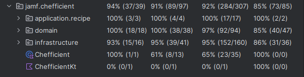
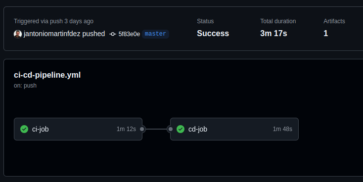

# Chefficient
#### "_Optimize food, buy smart_"
[](https://opensource.org/license/gpl-3-0)
[](https://github.com/jantoniomartinfdez/chefficient/actions/workflows/ci-cd-pipeline.yml)

[](https://app.codacy.com/gh/jantoniomartinfdez/chefficient/dashboard?utm_source=gh&utm_medium=referral&utm_content=&utm_campaign=Badge_grade)

[](https://chefficient.onrender.com/)

Chefficient is designed with the intent of smartly matching recipes to food and vice-versa, with the goal of reducing food waste and save money.

## Table Of Content

- [Actors](#Actors)
- [Features](#Features)
- [Roadmap](#Roadmap)
- [Glossary of terms](#Glossary-of-terms)
- [Tech Stack](#Tech-Stack)
- [API Reference](#API-Reference)
- [Environment Variables](#Environment-Variables)
- [Development Setup](#Development-Setup)
- [Run Locally](#Run-Locally)
- [Running Tests](#Running-Tests)
- [Deployment](#Deployment)

## Actors
- **Chef / Administrator:** individual who is trained to create recipes from scratch with fresh ingredients.
- **Cook / User:** individual who follows established recipes to prepare food and perform food logistics.

## Features
- **(M.V.P.)** Store recipes along with their ingredients specified in units of measurement.

## Roadmap
- **(M.V.P.)** Search recipes based on selected ingredients, order by the ones that contain more matches, in descendant order.
- **(M.V.P.)** List ingredients needed for a selected recipe.
- Show list of possible recipes based on inventory, order by the ones that can be fully done with existing ingredients, in descendant order.
- List ingredients needed for a selected group of recipes (food menu), previously added.
- Show summary menu, which involves total ingredients, missing ones, total recipes, total nutrition list, etc.
- List missing ingredients on inventory needed for a selected recipe, in order to buy them.

## Glossary of terms
- **Recipe:** a set of ingredients, instructions and optionally recommendations in order to elaborate a dish. It also contains a title, sometimes followed by a description to be easily identified.
- **Recipe group:** same as "menu", with fixed amount of recipes based on frequency (daily, weekly or monthly).
- **Ingredient:** a certain amount of food used as part of a recipe.
- **Inventory:** same as "pantry", a.k.a "Food Repository" here.
- **Food:** standalone and concrete edible item, used for one or many ingredients.

## Tech Stack
- **Programming language:** Kotlin
- **Framework web:** Javalin 6.3
- **Database:** PostgreSQL and Flyway for migrations
- **Dependency management:** Maven
- **Application server:** Jetty server embedded within Javalin
- **Security:** Basic Auth
- **API Documentation:** Swagger/OpenAPI Specification 3.0 (OAS 3.0)
- **Testing:** JUnit 5, AssertJ, MockK and Testcontainers


## API Reference

#### Store a recipe

```http
  POST /recipes
```

```bash
curl -X 'POST' \
  'https://chefficient.onrender.com/recipes' \
  -H 'accept: */*' \
  -H 'Authorization: Basic dGVzdDp0ZXN0' \
  -H 'Content-Type: application/json' \
  -d '
        {
            "title": "French Omelette",
            "ingredients": [
                {"first": "egg", "second": "3"},
                {"first": "salt", "second": "2 pinches"}
            ],
            "steps": [
                "Step 1",
                "Step 2",
                "Step 3"
            ]
            "description": "My description",
            "recommendation": "My recommendation"
        }
  '
```


## Environment Variables

To run this project, you will need to add the following environment variables to your .env file

`DB_URL`: The JDBC URL for a postgres DB

`DB_USERNAME`: DB user for dev environment

`DB_PASSWORD`: DB password for dev environment

`AUTHENTICATION_PASSWORD` : Basic auth password


## Development Setup
### Prerequisites
- Docker version 27.5.0 or greater
- Docker Compose version v2.32.3 or greater
- Java version: 19.0.2 or greater
- Apache Maven 3.6.3 or greater

### Steps

Clone the project

```bash
  git clone git@github.com:jantoniomartinfdez/chefficient.git
```

Go to the project directory

```bash
  cd chefficient
```

Launch external dependencies

```bash
  docker compose up -d
```

Build the artifact

```bash
  mvn clean package
```

Start the server

```bash
  java -jar target/app.jar
```

Open the application in your favourite browser

```bash
  firefox http://localhost:7070/
```
```bash
  google-chrome http://localhost:7070/
```

## Run Locally
### Prerequisites
- Docker version 27.5.0 or greater
- Docker Compose version v2.32.3 or greater

### Steps

Clone the project

```bash
  git clone git@github.com:jantoniomartinfdez/chefficient.git
```

Go to the project directory

```bash
  cd chefficient
```

Launch external dependencies

```bash
  docker compose up -d
```

Dockerize the application

```bash
  docker build -t chefficient-app .
```

Start the server

```bash
  docker run --network=host chefficient-app
```

Open the application in your favourite browser

```bash
  firefox http://localhost:7070/
```
```bash
  google-chrome http://localhost:7070/
```

## Running Tests

To run tests, run the following command
```bash
  mvn clean test
```

The whole project has been developed by following the TDD methodology. In order to structure the process, each TDD baby step has been committed separately with the following formats and rules:
- _"TestClass::methodName => [RED/GREEN/REFACTOR]"._
- Changes over code already in place, uses the closest test that provides the fastest feedback loop and the resulting commit message would look like _"ExistingTestClass::existingMethodName => REFACTOR"_.
- When no automated test is possible, changes are broken down into two phases:
  - One that includes the minimum code to get the manual test pass, like "Chefficient::reason of the change => RED + GREEN"
  - Followed by its improved version (if any), like "Chefficient::reason of the change => REFACTOR".
  
Among other side effects, the project has 100% of code coverage except in 2 production files. 



## Deployment

To deploy this project, just add any new commit or branch to master and then push it to GitHub. Local changes can be deployed into production environment in just a few minutes

```bash
  git push
```



